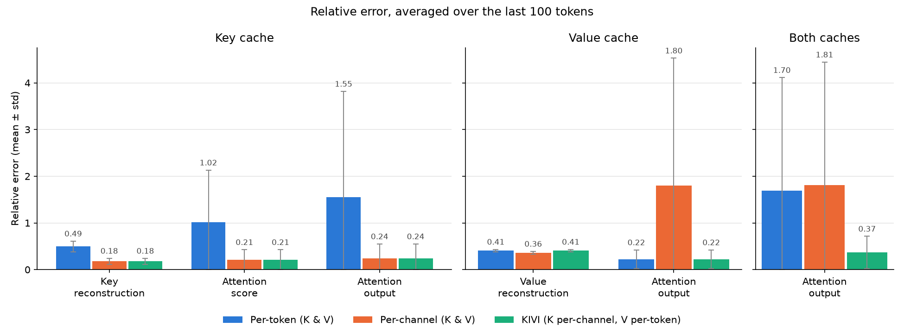

# dsc180-quantization

Experiments on **low-bit KV-cache quantization** for large language models, done for UCSD DSC 180A (Section D39).

The project reimplements and tests [KIVI](https://arxiv.org/abs/2402.02750) on **Qwen3-1.7B** with **LongBench** prompts. KIVI's main claim is:

> The **key** cache should be quantized **per channel**, and the **value** cache **per token**.

We test it in two ways:

1. **Offline:** save the real Q/K/V tensors from one prompt, quantize them, and measure how much error each method adds to attention.
2. **During generation:** run the model with a quantized KV cache, so the error passes through every layer and generated token, and score its answers with LongBench's official metrics.

Only the KV cache is quantized. The model weights stay in bf16.

## Quick start

Requirements: [uv](https://docs.astral.sh/uv/getting-started/installation/). It installs Python 3.13 (`.python-version`) and the exact package versions in `uv.lock`.

```bash
git clone --branch ac/week8 https://github.com/achinnam09/dsc180-quantization.git
cd dsc180-quantization
uv sync --frozen
uv run pytest        # no model or dataset download; under a minute
```

Run every command in this README from the repository root.

## Commands

| Target | Command | Needs | Writes |
|---|---|---|---|
| Unit tests | `uv run pytest` | nothing | nothing |
| Data | `uv run python src/inference/pull_cache.py` | model + data download | `kv_snapshots/layer.pt` (~390 MB) |
| Offline errors | `uv run python src/quantization/main.py` | the Data target | `results/*.csv`, `figures/*.png` |
| Compare answers | `uv run python src/inference/kivi_generate.py` | model + data download | prints to the terminal |
| One LongBench prompt | see [below](#one-longbench-prompt) | model + data download | `results/longbench/<run-name>/` |
| LongBench subset | see [below](#longbench-subset-gpu) | GPU | `results/longbench/<run-name>/` |

The Data target must run before Offline errors. The other targets are independent.

### Data and model

Nothing needs to be downloaded by hand. The first command that needs them downloads these from Hugging Face (no account or token required) into `~/.cache/huggingface`, or into `$HF_HOME` if it is set:

| What | Source | Revision used for our results |
|---|---|---|
| Model (~4 GB) | [`Qwen/Qwen3-1.7B`](https://huggingface.co/Qwen/Qwen3-1.7B) | `70d244cc86ccca08cf5af4e1e306ecf908b1ad5e` |
| Dataset (`data.zip`) | [`zai-org/LongBench`](https://huggingface.co/datasets/zai-org/LongBench) | `5e628be450b7e67fb7ae6e201bd6d8f7056f7672` |

The code loads the latest revision; it does not pin these.

**Hardware:** a CUDA GPU or Apple Silicon (MPS) is recommended. We developed on an 8 GB M2 MacBook. CPU works but is slow.

### Offline errors

```bash
uv run python src/inference/pull_cache.py    # 1. save Q/K/V for one prompt
uv run python src/quantization/main.py       # 2. quantize, measure errors, plot
```

Outputs:

- `results/error_summary.csv`: mean and std of each metric per method
- `results/head_errors.csv`: one row per (method, layer, head, position); about 18 MB, gitignored
- `figures/error_comparison.png`, `errors_by_layer.png`, `errors_by_position.png`, `kv_magnitudes.png`

Running `main.py` overwrites these files.

### Compare answers

Generates an answer to one prompt with each cache configuration and prints them together with the reference answer:

```bash
uv run python src/inference/kivi_generate.py --task multifieldqa_en --index 0
```

### One LongBench prompt

Reproduces the Qasper table in [Results](#generation-one-qasper-prompt). The two commands differ only in the prefill setting:

```bash
# Prefill attention reads the quantized cache (default)
uv run python src/evaluation/run_longbench.py --tasks qasper --n 1 --show \
    --configs fp16 kivi4 kivi2 token2 channel2 --run-name task3_qasper_quantprefill

# Prefill attention reads the exact K/V (KIVI paper)
uv run python src/evaluation/run_longbench.py --tasks qasper --n 1 --show \
    --configs fp16 kivi4 kivi2 token2 channel2 --run-name task3_qasper_exactprefill --exact-prefill
```

Each run directory contains `args.json` (settings), `run.log`, `scores.json`, and `<config>/<task>.jsonl` (one prediction per line).

- Re-running the same command skips finished prompts, so an interrupted run resumes. **Use a new `--run-name` whenever you change a setting**, or old and new predictions will be mixed.
- Add `--score-only` to re-score a finished run without generating. Pass the same `--tasks` and `--configs`.
- `--help` lists every option.

### LongBench subset (GPU)

This runs 30 prompts from each of KIVI's 8 LongBench tasks (240 prompts) on UCSD's DSMLP. **We have not completed this run yet, so there are no subset results to reproduce.**

```bash
# On dsmlp-login: launch a GPU pod, then open a shell in it
launch-scipy-ml.sh -W DSC180A_FA26_001 -g 1 -c 4 -m 32 -b
kubesh <pod-id>

# In the pod: clone the repo, install uv and packages, check the GPU
curl -LsSf https://raw.githubusercontent.com/achinnam09/dsc180-quantization/ac/week8/scripts/dsmlp_setup.sh | bash
source ~/private/.kivi_env && cd ~/private/dsc180-quantization

# Start everything in the background and follow the log
mkdir -p logs && nohup bash scripts/run_kivi_tests.sh > logs/kivi_tests.log 2>&1 &
tail -f logs/kivi_tests.log
```

`run_kivi_tests.sh` runs four stages in order. Choose some with `STAGES`, and the prompts per task with `N`:

| Stage | What it runs |
|---|---|
| `pytest` | Unit tests |
| `smoke` | One Qasper prompt, 5 configurations |
| `quant` | Subset, quantized prefill attention |
| `exact` | Subset, exact prefill attention |

```bash
STAGES="pytest smoke" bash scripts/run_kivi_tests.sh
N=5 STAGES="quant" bash scripts/run_kivi_tests.sh
```

If the pod has no `~/private`, the setup script uses `~` instead. Pods stop after 6 hours; run the same command again to resume. `scripts/fetch_results.sh` copies results back to your machine and needs an SSH host named `dsmlp`.

### Reproducibility

- **Offline errors:** no randomness; the prompt is fixed (`multifieldqa_en` #0).
- **Generation:** greedy decoding. `--seed` (default 0) fixes which prompts are selected.
- **Synthetic data:** `Synthesizer` is not seeded, so its output changes every run. It is not used for any result below.
- **Hardware:** bf16 arithmetic differs slightly between MPS and CUDA, so borderline answers can change. Our results are from MPS.

## Configuration

| File | Settings |
|---|---|
| `pull_cache.py` | `LONGBENCH_TASK`, `SAMPLE_INDEX`, `MAX_CONTEXT_TOKENS` (constants at the top) |
| `main.py` | `BITS`, `GROUP_SIZE`, `RESIDUAL_LENGTH`, `NUM_QUERY_TOKENS` (constants at the top) |
| `kivi_generate.py` | `MODEL_NAME`, `CONFIGS`; command-line options in `--help` |
| `run_longbench.py` | Command-line options in `--help` |

Cache configurations (`CONFIGS` in `kivi_generate.py`), all with `G=32` and `R=128`:

| Name | Keys | Values | Bits |
|---|---|---|---|
| `fp16` | not quantized | not quantized | 16 (baseline; the code uses bf16) |
| `kivi4` | per channel | per token | 4 |
| `kivi2` | per channel | per token | 2 |
| `token2` | per token | per token | 2 |
| `channel2` | per channel | per channel | 2 |

## Repository layout

```
src/
  inference/
    pull_cache.py         # Run Qwen3-1.7B on a LongBench prompt; save Q/K/V per layer
    kivi_generate.py      # Load the model/data, build caches, compare answers to one prompt
  quantization/
    quantize.py           # Offline (numpy) per-channel / per-token quantizers
    metrics.py            # Relative-error metrics
    main.py               # Offline experiment: errors over the last 100 positions, CSVs, figures
    visualize.py          # Plots
    kivi_cache.py         # KIVICache: the quantized cache used during generation
    synthesizer.py        # Synthetic Q/K/V with injected outliers
  evaluation/
    run_longbench.py      # LongBench generation and scoring
    longbench_metrics.py  # Official LongBench metrics
    config/               # Official LongBench prompt templates and max generation lengths
scripts/                  # DSMLP setup, GPU run, and fetching results
tests/                    # pytest unit tests
figures/                  # Generated plots
results/                  # Generated CSVs and LongBench runs
kv_snapshots/             # (gitignored) tensors from pull_cache.py
```

## Background

While generating text, a transformer stores the keys (K) and values (V) of all previous tokens so it doesn't have to compute them again. For long contexts this **KV cache** can use more memory than the model weights. Quantizing it to 2 bits cuts the codes to 1/8 of fp16. Counting each group's scale and zero point (fp16, `G=32`), it is about 3 bits per element, or about 5× smaller.

KIVI's observation:

- **Keys** have a few **outlier channels**: certain dimensions are much larger than the rest across *every* token. With one scale per token, those outliers inflate the scale and wipe out the precision of the other channels. Giving each channel its own scale avoids this.
- **Values** have no consistent channel outliers. Their error matters through the attention output `A·V`, which mixes tokens together, so quantizing **per token** keeps each token's error contained.
- The most recent tokens (the *residual*, up to **R**) stay in full precision.

## Method

### Quantization

All quantizers use **asymmetric uniform (min/max) quantization**, with a zero point `z = min` and a scale `s = (max − min) / (2^bits − 1)`:

```
q   = clip(round((X − z) / s), 0, 2^bits − 1)
X̂   = q · s + z
```

| Scheme | KIVI uses it for | Grouping | Full-precision residual |
|---|---|---|---|
| Per channel | Keys | Groups of `G` tokens; each channel gets its own scale in a group | Trailing `l mod R` tokens |
| Per token | Values | Each token gets its own scale over groups of `G` channels | Last `R` tokens |

Defaults: `bits=2`, `G=32`, `R=128`.

Everything here is *fake quantization* (quantize, then dequantize right away). It measures the effect on accuracy, but **does not reduce memory use**.

### Offline experiment

`main.py` compares per-token, per-channel and KIVI quantization. For each of the last 100 positions `t` of the prompt, it quantizes the cache as it would be at that step (tokens `0..t`) and scores it with that position's query. Results are averaged over positions, query heads and all 28 layers. Qwen3 uses grouped-query attention, so each KV head is scored against every query head that shares it.

Every metric is a norm-ratio relative error, `‖X − X̂‖ / ‖X‖`:

| Metric | Compares | Quantized |
|---|---|---|
| `key_reconstruction_error` | `K` and `K̂` | K |
| `attention_score_error` | `A = softmax(QKᵀ/√d)` and `Â` | K |
| `key_output_error` | `A·V` and `·V` | K |
| `value_reconstruction_error` | `V` and `V̂` | V |
| `attention_output_error` | `A·V` and `A·V̂` | V |
| `combined_output_error` | `A·V` and `·V̂` | both |

### Quantized cache during generation

`KIVICache` quantizes post-RoPE keys and values, as KIVI does.

- **Prefill:** the prompt enters the cache at once and everything outside the residual is quantized. By default, prefill attention reads the quantized cache, so errors propagate from the first forward pass. With `--exact-prefill` it reads the exact K/V, as in the KIVI paper.
- **Decode:** keys collect in a residual and are quantized per channel once it reaches `R` tokens. Values leave a sliding window of `R` tokens one at a time and are quantized per token.

## Results

### Offline errors

2 bits, `multifieldqa_en` #0 (1,699 tokens), mean over the last 100 positions, all query heads and layers:

| Metric | Per-token | Per-channel | KIVI |
|---|---|---|---|
| Key reconstruction | 0.495 | 0.177 | 0.177 |
| Attention score (K quantized) | 1.017 | 0.206 | 0.206 |
| Attention output (K quantized) | 1.551 | 0.239 | 0.239 |
| Value reconstruction | 0.409 | 0.357 | 0.409 |
| Attention output (V quantized) | 0.219 | 1.803 | 0.219 |
| **Attention output (both quantized)** | 1.696 | 1.808 | **0.366** |

KIVI has about 5× less combined attention-output error than either single scheme.



### Generation: one Qasper prompt

Qasper #53, 2,087 input tokens, QA-F1 (0–100) in parentheses. References: "using the Meaning Extraction Method" / "Unanswerable".

| Config | Quantized prefill | Exact prefill |
|---|---|---|
| `fp16` | "yes" (0) | "yes" (0) |
| `kivi4` | "yes" (0) | "yes" (0) |
| `kivi2` | "unanswerable" (100) | "yes" (0) |
| `token2` | gibberish (0) | "yes", then gibberish (0) |
| `channel2` | rambles, ends in "Yes." (9.1) | "yes" (0) |

This is **one prompt**, and the model gets it wrong even without quantization. It checks that the pipeline runs end to end; it does not show that one method is more accurate. `kivi2`'s score of 100 is luck: it changed the answer, and one annotator had marked the question unanswerable.

## References

- Liu et al., *KIVI: A Tuning-Free Asymmetric 2bit Quantization for KV Cache*, ICML 2024. [arXiv:2402.02750](https://arxiv.org/abs/2402.02750). Official code: [jy-yuan/KIVI](https://github.com/jy-yuan/KIVI)
- Bai et al., *LongBench: A Bilingual, Multitask Benchmark for Long Context Understanding*, 2023. [arXiv:2308.14508](https://arxiv.org/abs/2308.14508). Prompts, generation lengths and metrics are ported from the [official code](https://github.com/THUDM/LongBench) (MIT license).
- [Qwen3-1.7B](https://huggingface.co/Qwen/Qwen3-1.7B)
